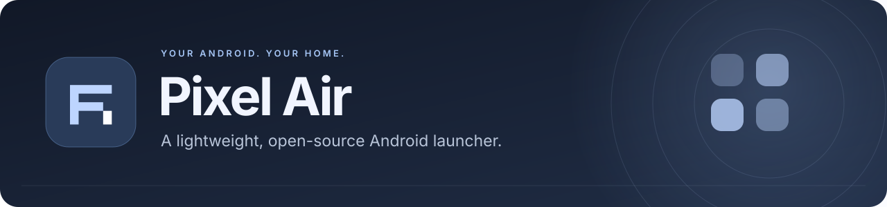
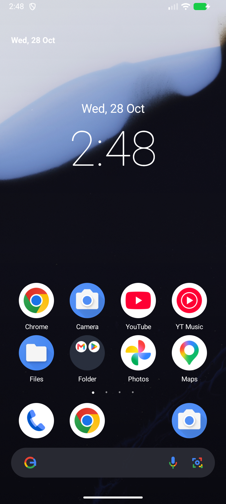
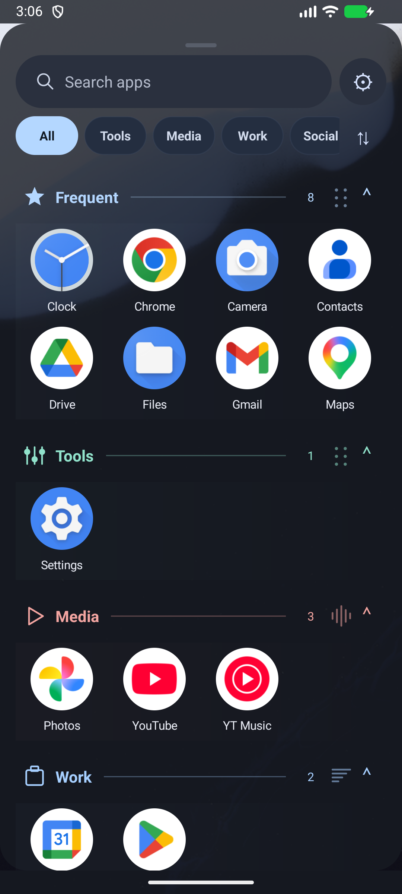
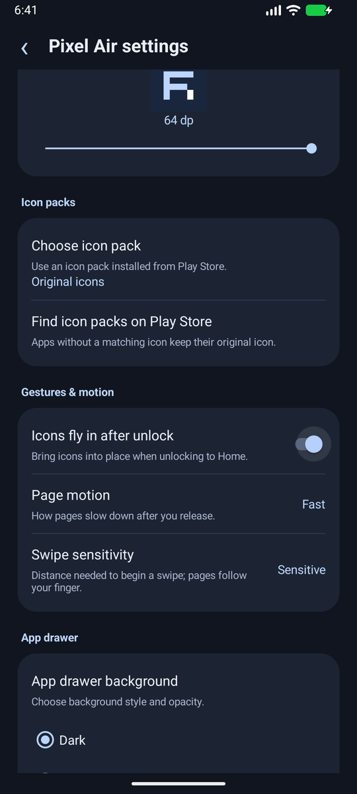
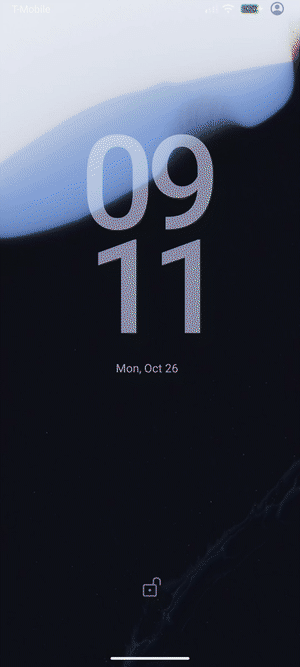
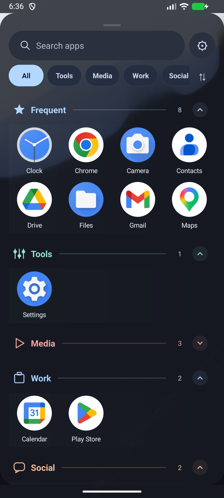
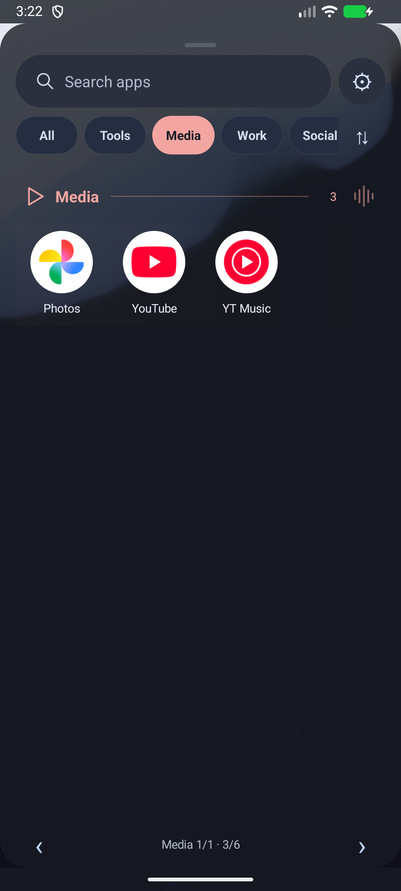

<p align="center">
  
</p>

<p align="center">
  <a href="https://github.com/hieupnvmg/pixel-air/releases/tag/v0.21"></a>
  
  <a href="LICENSE"></a>
</p>

<p align="center">Launcher Android gọn nhẹ, giao diện quen thuộc và nhiều tùy chọn để màn hình chính vừa ý bạn.</p>

<p align="center">
  <strong><a href="https://github.com/hieupnvmg/pixel-air/releases/tag/v0.21">Tải APK ↓</a></strong> · <a href="README.md">English</a> · <a href="docs/CHANGELOG.vi.md">Lịch sử thay đổi</a> · <a href="VALIDATION.md">Chi tiết kiểm tra</a>
</p>

## Một vòng giao diện

<table>
  <tr><th>Màn hình chính</th><th>Danh sách ứng dụng</th><th>Tùy chỉnh theo ý bạn</th></tr>
  <tr>
    <td align="center"></td>
    <td align="center"></td>
    <td align="center"></td>
  </tr>
</table>

Ảnh giao diện thật từ các bản thử nghiệm trên máy ảo. Chi tiết thiết bị đã thử nằm trong ghi chú kiểm tra.

## Mở khóa, bung icon liền mạch

<table>
  <tr>
    <td width="270" align="center">
      <picture>
        <source media="(prefers-reduced-motion: reduce)" srcset="docs/assets/home.png" />
        
      </picture>
    </td>
    <td>
      <h3>Từ hình nền đến màn hình chính.</h3>
      <p>Lưới icon bắt đầu nhỏ rồi bung đồng bộ về vị trí, thay vì hiện đầy đủ trước rồi mới chạy lại.</p>
      <ul>
        <li>Một lần chuyển động cho mỗi lần mở khóa</li>
        <li>Widget và hình nền đứng yên</li>
        <li>Tôn trọng tùy chọn animation của Android</li>
      </ul>
      <a href="https://github.com/hieupnvmg/pixel-air/releases/download/v0.11/PixelAir-0.11-unlock.mp4">Xem video đầy đủ →</a>
    </td>
  </tr>
</table>

## Tính năng

- Nhiều trang Home, dock chung, thư mục, kéo icon giữa các trang.
- Vuốt lên mở drawer; tìm kiếm, ABC hoặc hai hàng hay dùng + phân nhóm app; sửa nhóm thủ công.
- Icon pack dạng appfilter, thay icon riêng và chỉnh kích thước 36–64 dp.
- Nền tối/kính mờ; mặc định nền tối 80% và xếp app theo loại.
- Một widget: xem trước, chọn trang/vị trí, kéo đổi cỡ và xóa. Lưu widget mới sẽ thay widget hiện tại.
- Hiệu ứng mở khóa: icon được ẩn sau màn khóa rồi bung đồng bộ từ nhỏ ra lớn khi Home bắt đầu vẽ.
- Cài đặt riêng, tự theo ngôn ngữ hệ thống Việt/Anh.

## Tải bản thử

[Tải APK 0.21 trên GitHub Releases](https://github.com/hieupnvmg/pixel-air/releases/tag/v0.21). Đây là bản debug để thử nghiệm.

## Build

Cần Android Studio, SDK Platform **37**, JDK **25**. Gradle Wrapper 9.6.0 và Android Gradle Plugin 9.4.1 đã được cấu hình; Java source tương thích 17.

Mở thư mục trong Android Studio để tạo `local.properties`, hoặc đặt `ANDROID_HOME` tới thư mục SDK. Chạy:

```sh
./gradlew assembleDebug lintDebug
./scripts/test-models.sh
```

APK nằm ở `app/build/outputs/apk/debug/app-debug.apk`. Đây là bản debug để thử; cấu hình SDK của máy và khóa ký không nằm trong repo.

Trên Mac, nếu JDK đi kèm Android Studio là bản 25:

```sh
export JAVA_HOME='/Applications/Android Studio.app/Contents/jbr/Contents/Home'
./gradlew assembleDebug lintDebug
./scripts/test-models.sh
```

Windows có thể build trong Android Studio; script test model cần Git Bash hoặc WSL.

## Cách dùng

Cài APK và đặt Pixel Air làm ứng dụng màn hình chính mặc định. Giữ vùng trống Home để mở cài đặt, widget hoặc chế độ chỉnh bố cục. Giữ widget rồi thả tay để di chuyển/đổi cỡ/xóa. Công tắc hiệu ứng mở khóa nằm trong **Cử chỉ & chuyển động**.

## Trạng thái

Đây là prototype độc lập, không phải Pixel Launcher chính thức. Hiện kiểm tra chủ yếu trên máy ảo Android 17/API 37, chưa được maintainer xác minh trên REDMAGIC thật. Hiệu ứng hệ thống, Recents và cơ chế mở khóa vẫn do ROM quản lý. Chỉ hỗ trợ một widget tại một thời điểm.

Khi báo lỗi, vui lòng ghi model máy, phiên bản Android/ROM, phiên bản launcher và các bước tái hiện. Mã nguồn dùng giấy phép [Apache 2.0](LICENSE); đóng góp và pull request đều được chào đón.

### App drawer 0.17

Các nhóm mặc định mở sẵn, có thể chạm tiêu đề để thu gọn hoặc mở rộng, hiện đầy đủ ứng dụng trong một danh sách cuộn. Launcher ghi nhớ trạng thái từng nhóm. Chip tự mở nhóm trước khi cuộn đến; tìm kiếm vẫn lấy app trong các nhóm đã thu gọn. Mỗi nhóm có biểu tượng, màu nhấn và số ứng dụng riêng; hai hàng Hay dùng không trùng app với các nhóm bên dưới.

<p align="center"></p>

### Cuộn ngang tùy chọn

Vào **Cài đặt Pixel Air → Danh sách ứng dụng → Hướng cuộn → Ngang**. Vuốt trái/phải đổi trang theo nhóm; nhóm nhiều app tự chia thêm trang. Chip nhảy đến trang đầu của nhóm, tìm kiếm lấy app ở mọi trang. Chế độ ngang hiển thị đủ app và không dùng thu/mở nhóm; trạng thái thu gọn vẫn được giữ cho chế độ dọc. Dọc vẫn là mặc định.

<p align="center"></p>

### Trở về Home và đa nhiệm

Bản 0.17 bỏ hoàn toàn hiệu ứng trở về Home được thêm ở 0.16 vì người dùng báo phản hồi chậm. Chỉnh cách tách task của Home theo Launcher3 và chuyển cập nhật task cũ ra khỏi luồng UI. Máy giả lập không hiện thẻ Pixel Air trong đa nhiệm, nhưng lỗi trên REDMAGIC khi vuốt từ Home vẫn cần kiểm chứng thực tế; không coi đây là lỗi đã xác nhận sửa xong.

### Kiểu mở khóa iPhone tùy chọn

Vào **Cài đặt → Cử chỉ & chuyển động → Kiểu hiệu ứng mở khóa → Kiểu iPhone**, rồi bấm **Xem thử hiệu ứng mở khóa**. Lưới icon lớn thu về vị trí, dock hiện từ dưới trong khoảng 600 ms; kiểu hiện tại vẫn là mặc định. Tham khảo [clip người dùng gửi](https://www.youtube.com/shorts/ncvc6Vi0CFo), không phải chuyển cảnh màn khóa hệ thống iOS.

[Xem video kiểu mở khóa iPhone trên máy giả lập](https://github.com/hieupnvmg/pixel-air/releases/download/v0.21/PixelAir-0.21-unlock.mp4). Đây là quay app thật; chuyển cảnh màn khóa vẫn do hệ thống quản lý.
